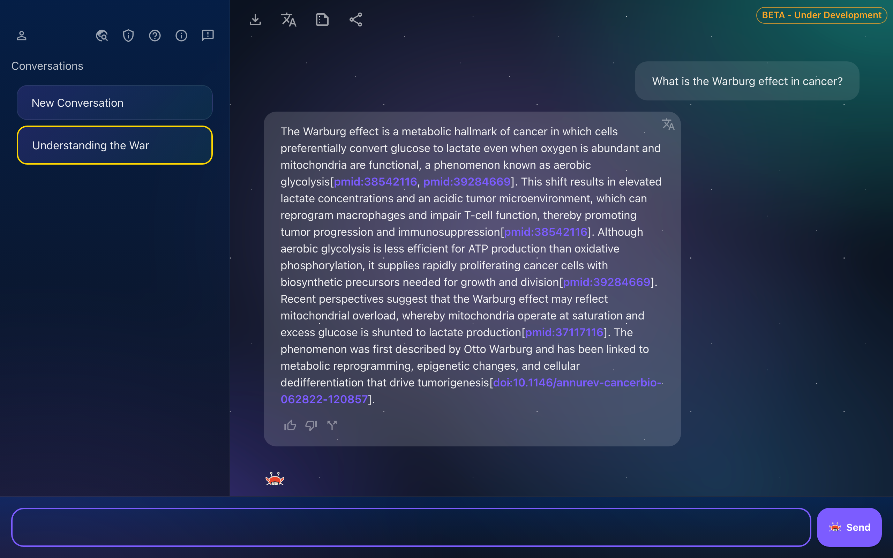
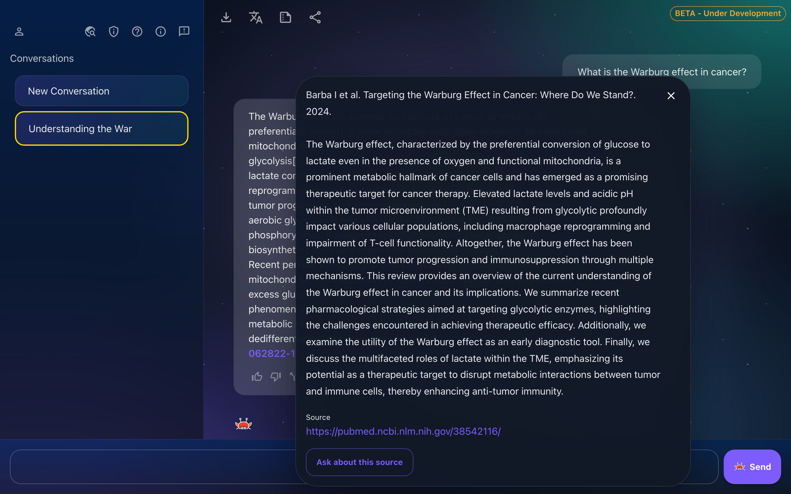
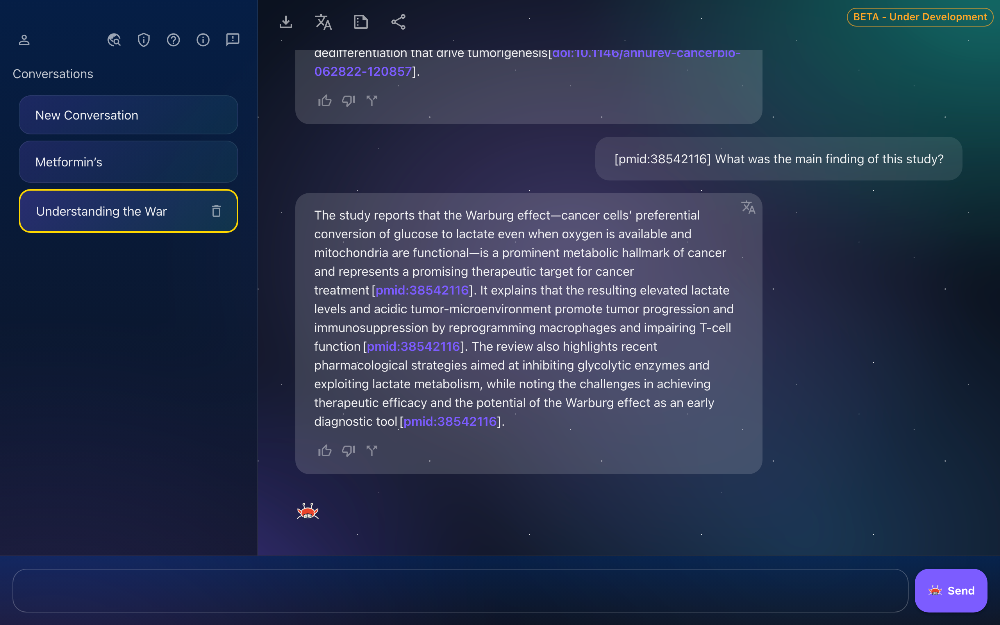
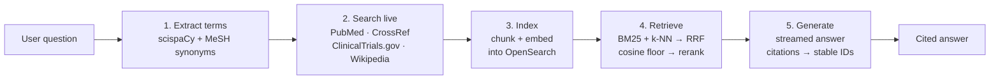

# CancerBot

[](https://github.com/roy-ka/cancerbot/actions/workflows/test.yml)
[](LICENSE)
[](https://www.python.org/downloads/release/python-3120/)

**A cancer-information chatbot that searches PubMed, CrossRef, ClinicalTrials.gov and Wikipedia live for every question, and answers only from what it found — with every claim cited.**

> **Medical disclaimer.** CancerBot is an information tool, not a medical device. Its answers are generated by a language model from retrieved literature and can be incomplete or wrong. Nothing it says is medical advice — always discuss diagnosis and treatment decisions with a qualified clinician.

<p align="center">
  
</p>

| Cited answers | Source details | Ask about a specific source |
|---|---|---|
|  |  |  |

## Why it's interesting

- **Hybrid retrieval fused by rank, not score.** Dense (k-NN vector) and lexical (BM25) searches run as two independent ranked lists in a single OpenSearch request and are combined with Reciprocal Rank Fusion (`k = 60`). Their raw scores live on different scales, so fusing by rank stops one half from drowning the other. The dense half embeds the user's natural question, while BM25 gets the extracted medical terms.
- **Relevance-gated, then reranked.** Instead of a fixed top-k, every source whose best chunk clears a cosine-similarity floor is kept (capped at 10), so off-topic questions don't get padded with noise. A cross-encoder (`ms-marco-MiniLM-L-6-v2`) then reorders the survivors.
- **A corpus that grows with use.** There is no offline ingestion. Every question triggers live searches of four public sources; new results are chunked, embedded and indexed on the spot, so the next similar question is answered from a richer index.
- **Citations rewritten to stable IDs.** The model only ever sees short aliases (`[source1]`, `[source2]`…); after generation they are rewritten to permanent identifiers — `pmid:…`, `doi:…`, `nct:…` — that stay valid across conversations, exports and shared links. The same paper reached through PubMed and CrossRef is deduplicated by DOI.

Also: questions about the user's own saved profile ("what stage did I save?") are answered deterministically from the profile, never by the model; and all retrieved text is fenced as untrusted evidence in the prompt to resist injected instructions.

## How it works



1. **Extract terms.** An NLP service (scispaCy) pulls biomedical entities out of the question and expands them with MeSH synonyms.
2. **Search live.** PubMed, CrossRef, Wikipedia and ClinicalTrials.gov are queried in parallel with those terms.
3. **Index.** New results are chunked, embedded with `nomic-embed-text` (Ollama), and added to OpenSearch.
4. **Retrieve.** A hybrid search runs dense (vector) and lexical (BM25) queries, fuses them with Reciprocal Rank Fusion, keeps only sources above a cosine-similarity floor, and reorders them with a cross-encoder.
5. **Generate.** An LLM writes a streamed answer citing `[source1]`, `[source2]`…, which are rewritten to stable IDs such as `pmid:12345`. `LLM_PROVIDER` picks the one model that writes it: a local Ollama model (the default), Groq (`openai/gpt-oss-120b`) or Gemini.

## Fastest way to try it

You need Docker, [Ollama](https://ollama.com), Python 3.12 and Node.js 20.19+, plus a model to write the answers: a local Ollama chat model (the default, no cloud account needed), or a free [Groq API key](https://console.groq.com/keys).

**1. Clone and configure**

```bash
git clone https://github.com/roy-ka/cancerbot.git
cd cancerbot
cp example.env .env
echo "VITE_BASE_URL=http://localhost:8000" > client/.env
python3 -c "import secrets; print(secrets.token_hex(32))"   # copy the output for JWT_SECRET
```

In `.env`, set these lines (everything else can stay as it is for a local run):

```
JWT_SECRET=<the 64-character value printed above>
DEV_EMAIL_SHORTCUTS=true
```

Answers come from the local model in `OLLAMA_GEN_MODEL` (`llama3.1:8b` by default — run `ollama pull llama3.1:8b`). To use Groq instead, set these two:

```
LLM_PROVIDER=groq
GROQ_API_KEY=<your Groq key>
```

`DEV_EMAIL_SHORTCUTS=true` skips email verification, so you can register and log in straight away without an email provider.

**2. Start the services**

```bash
docker compose up -d          # OpenSearch, Dashboards, PostgreSQL, NLP service
ollama pull nomic-embed-text  # embedding model (the Ollama app must be running)
```

The first run builds the NLP service image, which downloads the scispaCy model and can take a few minutes. OpenSearch runs two nodes with 2 GB heaps each, so give Docker plenty of memory. On Linux, OpenSearch also needs `sudo sysctl -w vm.max_map_count=262144`.

**3. Run the backend**

```bash
python3.12 -m venv .venv
source .venv/bin/activate
pip install -r requirements.txt
alembic upgrade head
uvicorn src.main:app --reload
```

**4. Run the frontend** (in a second terminal)

```bash
cd client
npm install
npm run dev
```

Open http://localhost:5173, register, and ask a question. The first answer on a new topic takes a little longer while sources are fetched and indexed.

## Features

- Cited answers, with a popover for each source (abstract, link, clinical-trial phase and status)
- Follow-up questions about one specific cited source ("Ask about this source")
- An optional health profile (cancer type, stage, biomarkers, age band, treatment status) that frames answers; questions about the profile itself are answered from it directly
- Shareable read-only conversation links, and export to Markdown or print-to-PDF
- A clinical-trial finder that opens a recruiting-filtered ClinicalTrials.gov search
- Answer feedback and conversation splitting
- Email-verified accounts with password reset, email change and account deletion
- An admin console for browsing users and conversations

## Stack

| Component | Technology | Port |
|---|---|---|
| API | FastAPI (REST + WebSocket streaming) | 8000 |
| Frontend | React 19 + Vite + MUI | 5173 |
| Search | OpenSearch 3 (2 nodes) — BM25 + k-NN | 9200 |
| Database | PostgreSQL + Alembic | 5432 |
| NLP service | scispaCy `en_core_sci_sm` + cross-encoder reranker | 8100 |
| Embeddings | Ollama `nomic-embed-text` (runs natively) | 11434 |
| Generation | One of: local Ollama model (default), Groq, Gemini — set by `LLM_PROVIDER` | — |
| Background jobs | arq + Redis (emails, scheduled deletions, cleanup) | 6379 |
| Email | Brevo | — |

## More local options

**Choosing the model.** `LLM_PROVIDER` is `ollama` (default, uses `OLLAMA_GEN_MODEL`), `groq` (needs `GROQ_API_KEY`) or `gemini` (needs `GEMINI_API_KEY`). Only the chosen provider is ever called — there is no fallback — and the backend refuses to start if its settings are missing.

**Email flows.** No email is sent outside production. With `DEV_EMAIL_SHORTCUTS=true`, registration creates an already-verified account and "Forgot password" goes straight to the set-new-password page; it's refused when `ENV=production`, and the backend test suite runs with it off. Without it, the `POST /auth/register/` response includes a `verification_token` (visible in your browser's network tab); open `http://localhost:5173/verify-email?token=<token>` to verify.

**Background jobs.** Emails and scheduled account deletions run in the arq worker, which needs Redis. Without them the app still works; queued jobs are logged and skipped. To run them, start Redis (`docker compose --profile prod up -d redis`) and then the worker (`arq src.worker.WorkerSettings`).

`example.env` documents every variable. Keep `ENV=development` locally.

## Tests

```bash
pytest                    # backend (no services needed)
cd client && npm test     # frontend
```

The NLP service and Playwright end-to-end suites are covered in [TESTING.md](TESTING.md). CI runs the backend, NLP service and frontend suites on every push and pull request.

## Repository layout

```
src/            FastAPI app — routers/, db/ (models + repositories), retrieval/, jobs/, classes/ (LLM client)
client/         React frontend
nlp_service/    Term extraction, spelling correction, reranking (separate container)
alembic/        Database migrations
tests/          Backend tests
e2e/            Playwright end-to-end tests
scripts/        Deploy, backup and one-off data-migration scripts
```

[CLAUDE.md](CLAUDE.md) is the detailed architecture reference: request flow, retrieval design, security decisions and known limitations. It's written for AI coding assistants but is equally useful to human contributors.

## Known limitations

- **Small local models give weaker answers.** The prompts and citation rules are tuned for `openai/gpt-oss-120b`; models like `llama3.1:8b` follow them less reliably.
- **Answers take several seconds.** Every question runs live searches against four external services, and indexes anything new, before generation starts.
- **A new deployment starts with an empty index.** The corpus is built from what users ask, so early answers draw on fewer sources.
- **English-centric search.** Term extraction uses an English biomedical model, so questions in other languages get a weaker literature search (answers still follow the conversation's language).
- **Retrieval tuning is heuristic.** There is no offline evaluation set yet; fusion and boost weights are reasoned defaults rather than measured ones.

## Running in production

Production uses `docker compose -f docker-compose.yml -f docker-compose.prod.yml --profile prod up -d --build`: the second file turns on OpenSearch TLS (local development runs it over plain HTTP), and the `prod` profile adds the backend, worker and Redis containers. `scripts/deploy.sh` is the full deploy (image build, Trivy scan, migrations, health check, nginx reload). The live server runs on Hetzner Cloud; [docs/server-runbook.html](docs/server-runbook.html) walks through setting one up from scratch, including the Cloud Firewall that keeps Ollama and port 8000 off the internet. [DEPLOY_EC2.md](DEPLOY_EC2.md) and [DEPLOY_ORACLE_CLOUD.md](DEPLOY_ORACLE_CLOUD.md) cover other hosts; backups are in [BACKUP.md](BACKUP.md).

Set `LLM_PROVIDER=groq` (or `gemini`), `ENV=production` (outside production, token-issuing endpoints return their tokens in the response for test automation) and `FRONTEND_URL` to your public origin; the backend refuses to start in production without it, or without an `https://` `OPENSEARCH_URL`.

## Contributing

Issues and pull requests are welcome. Please run the backend and frontend tests before opening a PR, and include tests with any change. If you find a security issue, please report it privately as described in [SECURITY.md](SECURITY.md) rather than opening a public issue.

## License

[GNU Affero General Public License v3.0](LICENSE). If you run a modified version of CancerBot as a network service, you must make your modified source available to its users.
